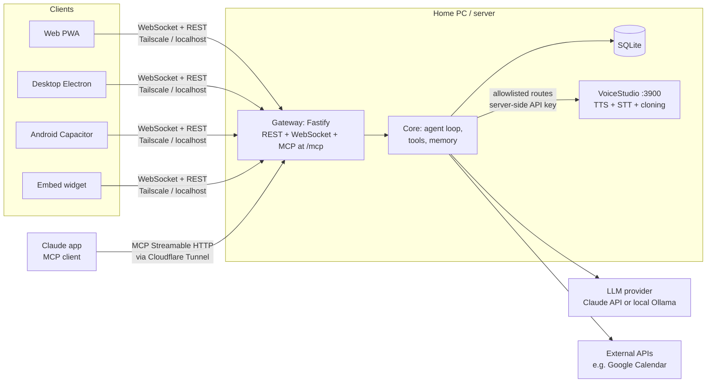
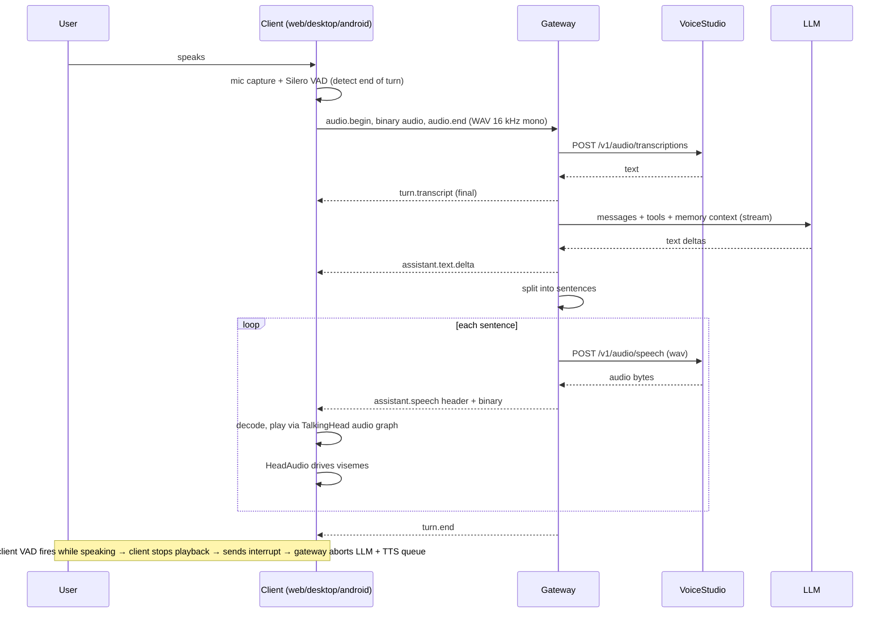
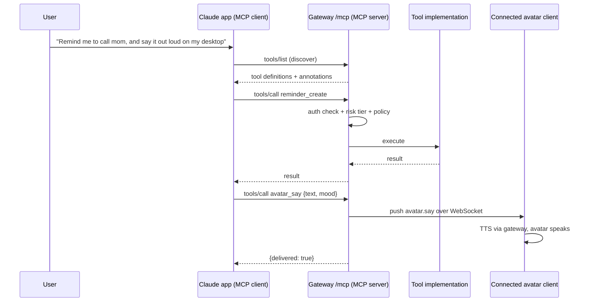
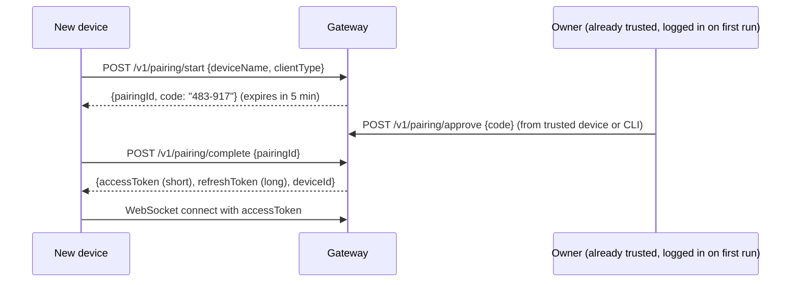

# Companion — Personal AI Voice Agent with 3D Avatar
## Product Requirements Document (PRD) v1.0

| Field | Value |
|---|---|
| Date | 2026-11-04 (research date for all external facts) |
| Owner | Solo developer (Pune, India) |
| Audience | Google Antigravity coding agents + the developer |
| Status | Approved for build, MVP-first |
| Codename | `companion` (assistant name, voice, avatar are configurable) |

---

## 0. How to use this document (read first, Antigravity)

1. Build **one phase at a time** (Section 19). Do not start a phase before the previous phase's Definition of Done (DoD) passes.
2. **Phase 0 (spikes) comes first.** Several facts are marked **VERIFY**. Run the spike, record the result in `docs/decisions/NNN-title.md`, then continue. Do not guess.
3. Keep every external service behind an interface (Section 8.2). Replacing an LLM, STT, TTS engine or avatar renderer must not require touching the agent loop.
4. Prefer the simplest thing that works (a modular monolith, not microservices).
5. Never put secrets in client code or in the repo.
6. If this PRD conflicts with reality (an API differs, a library is broken), stop, write an ADR (decision record) in `docs/decisions/`, and choose the smallest deviation.
7. Standing rules live in `AGENTS.md` (short, under Antigravity's rules size limit). This file is the full spec.

---

## 1. Overview

### 1.1 Vision
One personal AI assistant, created once, reachable everywhere: a consistent **name, voice, personality, animated 3D avatar, memory and toolset** on the web, Windows desktop, Android, inside Claude (via MCP), and embeddable in other websites.

### 1.2 Problem statement
Today's assistants are siloed per app. Each has its own memory, no shared identity, and none speaks in a voice I own with a face I chose. Cloud voice agents also send my voice and memories to third parties.

### 1.3 Objectives
- **O1** Natural voice conversation with sub-3-second response start and working interruption.
- **O2** A 3D avatar whose lips match the generated speech, with mood and gestures.
- **O3** A real agent: tool use, long-term memory, approvals for risky actions.
- **O4** One backend, many clients; shared identity and memory.
- **O5** Capabilities reusable by other AI clients (Claude first) through MCP.
- **O6** Privacy-first: voice synthesis and transcription run locally through VoiceStudio.
- **O7** A learning project: every component is documented so I understand it.

### 1.4 Target user
Primary and only user in v1: the owner (single-user, multi-device). Multi-user is a non-goal.

### 1.5 Non-goals (v1)
- Photoreal video avatar (Duix-Avatar and similar). Deferred, see Section 22.
- Multi-tenant SaaS, billing, public sign-up.
- UI automation or "computer use" on the desktop or phone.
- Replacing the phone's system assistant.
- Training or fine-tuning models.

---

## 2. Core use cases

| ID | Use case | Example |
|---|---|---|
| UC1 | Talk to the assistant by voice, see it speak | "What's the plan for tomorrow?" → avatar answers aloud |
| UC2 | Interrupt it mid-sentence | User starts speaking, avatar stops within 300 ms |
| UC3 | Ask it to use a tool | "Check my calendar for tomorrow." → calendar tool → spoken summary |
| UC4 | It remembers me | "Remember I prefer mornings for meetings." Later it uses that fact |
| UC5 | Approve a risky action | "Create an event at 5 PM." → avatar asks, on-screen Approve button |
| UC6 | Use it from Claude | In Claude: "Ask my assistant to remind me…" → tool call → avatar speaks on my desktop |
| UC7 | Use it on Android and desktop | Same name, voice, memory on every device |
| UC8 | Embed it in a website I control | `<companion-avatar>` widget talks to my backend |

---

## 3. Scope (MoSCoW)

**Must (MVP = Phases 0-5)**
- Gateway backend with LLM streaming, persona, WebSocket session protocol.
- Voice loop: mic → VAD → STT (VoiceStudio) → LLM → TTS (VoiceStudio) → playback.
- 3D avatar in the browser (TalkingHead + HeadAudio) with audio-driven lip-sync, moods, gestures.
- Interruption (barge-in) and push-to-talk.
- Tool calling with risk tiers and approvals; at least: time, notes/reminders, calendar read.
- Long-term memory (facts) with view and delete.
- MCP server (Streamable HTTP) usable from Claude as a custom connector.
- Device pairing authentication.

**Should (Phase 6)**
- Windows desktop app (Electron): floating transparent avatar, global push-to-talk hotkey, tray.
- Android app (Capacitor wrapper of the web client) with mic and foreground service.

**Could (Phase 7)**
- Embeddable SDK and Web Component, wake word, streaming STT, custom cloned voice, local LLM mode, Android overlay, extra MCP integrations, browser extension, multi-agent workflows.

**Won't (v1)**
- See non-goals (Section 1.5).

---

## 4. Technology decisions (final stack)

One primary stack, chosen to minimise unnecessary complexity for a solo developer. Alternatives are listed so a swap is possible, not so the choice stays open.

| Area | Decision | Why | Main alternative |
|---|---|---|---|
| Language | **TypeScript** everywhere (Node 20+ LTS) | One language for gateway, MCP server, web, desktop, Android wrapper. Avatar libraries are JS. Shared types. | Python FastAPI backend (good, but doubles languages) |
| Repo | **pnpm monorepo** | Shared `protocol` and `core` packages, atomic changes | Multi-repo (overhead) |
| Backend | **Fastify** + `@fastify/websocket` | Fast, typed, simple plugins, rate-limit plugin | Hono, NestJS (heavier) |
| Validation | **zod** | One schema for WS messages, REST and MCP tool input | TypeBox |
| Speech engine | **VoiceStudio** (local, port 3900) | Local TTS, STT, voice cloning, 646 languages, OpenAI-compatible routes | Cloud TTS (cost, privacy) |
| STT | VoiceStudio `/v1/audio/transcriptions` (batch per utterance) in MVP; VoiceStudio streaming WebSocket later | Local, free | Whisper via other servers |
| TTS | VoiceStudio `/v1/audio/speech`, sentence by sentence | Local, cloneable voice | HeadTTS (in-browser, English only) as fallback |
| VAD | **Silero VAD in the browser** (`@ricky0123/vad-web`, **VERIFY** current version) | Accurate, client-side, no server round trip | TalkingHead's built-in volume-based listening (weaker) |
| Avatar | **TalkingHead** (MIT) + **HeadAudio** (MIT) on Three.js | Real-time 3D lip-sync, moods, gestures, no server needed | VRM + three-vrm (more custom work), Unity (overkill) |
| LLM | **Provider interface**. Default: **Anthropic Claude API**. Also: any OpenAI-compatible endpoint (e.g. local Ollama) | Streaming + tool use; local option keeps it free | OpenAI, Gemini |
| Agent orchestration | **Direct tool-use loop** in `packages/core` | Small, transparent, teachable. No framework lock-in. | LangGraph (later, if multi-agent is needed) |
| Database | **SQLite** (`better-sqlite3` + Drizzle ORM) with FTS5 | Zero ops, single file, easy backup | Postgres + pgvector (when going multi-device cloud) |
| Memory retrieval | MVP: structured facts + FTS5 keyword search. Phase 7: embeddings (local) + `sqlite-vec` | Avoid vector DB complexity early | Chroma, Qdrant, Pinecone |
| MCP | **Official TypeScript SDK** `@modelcontextprotocol/sdk`, **Streamable HTTP** transport | Official; current transport | stdio (local-only clients) |
| Web client | **React + Vite + TypeScript**, installable as PWA | Fast to build, one UI for all platforms | Next.js (SSR not needed) |
| Desktop | **Electron** | Transparent always-on-top window, global shortcuts, tray; same stack as VoiceStudio | Tauri (smaller, but more native work) |
| Android | **Capacitor** wrapping the web client; native Kotlin only for overlay (Phase 7) | Reuses the avatar page | Flutter / React Native (would rewrite the avatar) |
| Remote access | **Tailscale** (private) for own devices; **Cloudflare Tunnel** (public HTTPS) only for the Claude connector | Free tiers, no port forwarding | VPS reverse proxy |
| Auth (own devices) | Device pairing code → signed token (JWT) | Single user, simple | Full OAuth for devices (overkill) |
| Auth (MCP) | OAuth 2.1 profile per MCP spec, delegated to a hosted identity provider (**decide in Phase 5**) | Spec-aligned, Claude connector compatible | API key header (only if the client supports it) |
| Tests | Vitest (unit), Playwright (web e2e), a scripted "voice turn" integration test | Standard | Jest |
| Package/CI | pnpm, GitHub Actions | Standard | |

---

## 5. What VoiceStudio and TalkingHead actually provide

This section lists verified facts from official repositories (researched 2026-11-04) and their limits. Treat limits as design constraints.

### 5.1 VoiceStudio (`github.com/debpalash/VoiceStudio`)
- Open-source (AGPL-3.0), fully local, runs as desktop app (Electron) with a Python backend. Default speech engine: k2-fsa/OmniVoice. Many other engines selectable in its Model Manager.
- **Local API base:** `http://localhost:3900` (port from `OMNIVOICE_PORT`, default 3900). OpenAI-compatible base URL is `http://localhost:3900/v1`.
- **Documented routes:**
  - `POST /v1/audio/speech` → TTS. Body like `{"model":"tts-1","voice":"<profile-id or alloy>","input":"text","response_format":"wav"}`. OpenAI voice names are only compatibility aliases. Prefer a saved voice profile ID for a stable voice.
  - `POST /v1/audio/transcriptions` → STT (multipart file upload) with the active engine.
  - `GET /v1/audio/voices` → list voices (VoiceStudio extension).
  - `GET /v1/models`, `GET /.well-known/voicestudio-speech` (capabilities).
  - WebSocket `ws://127.0.0.1:3900/v1/audio/transcriptions/stream` for live partial/final text. Binary WebM/Opus by default, or raw PCM16 mono with `?pcm=1&sr=16000`; finish with `{"type":"input_audio.end"}`.
  - MCP server mounted at `http://localhost:3900/mcp` with tools `generate_speech`, `clone_voice`, `transcribe`, `list_voices`, `list_personalities`, `list_languages`, `check_health`.
- **Auth model:** loopback needs no credential. For remote use, `OMNIVOICE_API_KEY` is sent as a Bearer token. **That key is a root credential, not a per-route token.** Do not expose it to clients. Our gateway holds it and exposes only what clients need.
- **Not implemented:** OpenAI's Realtime transcription WebSocket. Do not design around the OpenAI Realtime protocol.
- **Hardware:** NVIDIA CUDA, Apple Metal, AMD ROCm/Vulkan, or CPU (slower). Speed depends on engine. **VERIFY** real latency in Phase 0.
- **Unknown (VERIFY in Phase 0):** whether `/v1/audio/speech` supports chunked/streamed responses; per-sentence latency for the chosen engine; Hindi/Marathi TTS and ASR quality; how to create a cloned voice profile via REST (native endpoints are broader than the OpenAI-compat API and evolve; inspect the running backend's route list or OpenAPI page, or use the VoiceStudio UI to create the profile once).
- **Licence note (not legal advice):** AGPL-3.0 applies to VoiceStudio itself. Running it unmodified as a separate process and calling it over HTTP is the intended pattern. If you modify it and offer it to others over a network, AGPL obligations apply. Model weights and voices have their own licences (shown in its Model Manager). Clone only voices you have permission to use.

### 5.2 TalkingHead (`github.com/met4citizen/TalkingHead`, MIT)
- Browser JS class for a full-body 3D avatar (GLB) with real-time lip-sync, moods (`neutral, happy, angry, sad, fear, disgust, love, sleep`), gestures (`handup, index, ok, thumbup, thumbdown, side, shrug`), emoji expressions, eye contact, idle animation. Uses Three.js/WebGL. Tested on desktop Chrome, Firefox, Safari, Edge and iPad.
- **Avatar requirement:** GLB with a **Mixamo-compatible rig** plus **ARKit (52)** and **Oculus viseme (15)** blend shapes. Avatars can be made with MPFB for Blender (CC0 assets), Avaturn (free for non-commercial), VRoid Studio (needs Blender conversion), others. **Check every avatar's licence**; the repo's sample Ready Player Me avatar is non-commercial.
- **Key methods:** `showAvatar`, `speakAudio(audio, opt, onsubtitles)` (accepts an `AudioBuffer` or PCM16 chunks, with optional word timings), `speakText` (built-in text lip-sync only for English, German, French, Finnish, Lithuanian; default TTS is Google Cloud, which we do **not** use), `streamStart / streamAudio / streamNotifyEnd / streamInterrupt / streamStop` (streaming mode), `setMood`, `playGesture`, `lookAtCamera`, `makeEyeContact`, `setView('full'|'mid'|'upper'|'head')`, `start/stop`.
- **Our use:** we bypass its TTS and text lip-sync. VoiceStudio produces the audio; **HeadAudio** drives the mouth from the audio itself.

### 5.3 HeadAudio (`github.com/met4citizen/HeadAudio`, MIT)
- Audio worklet that detects Oculus visemes from audio in real time (MFCC features + a classifier). Needs no text or timestamps. Works with any audio stream. Fully in-browser. About 50 ms end-to-end viseme latency in the author's tests.
- Connect it to TalkingHead's speech gain node (`head.audioSpeechGainNode.connect(headaudio)`), set `headaudio.onvalue` to write blend-shape values, and call its `update` from TalkingHead's animation loop (`head.opt.update`). Optional `DelayNode` (about 0.1 s) to compensate processing latency.
- **Limits (author's own warning):** accuracy is "far from optimal", especially with low SNR; less accurate than text-driven lip-sync. The bundled model `model-en-mixed` was **trained on English voices**. **Accuracy on Hindi/Marathi is unknown. VERIFY in Phase 0 (Spike S3).**
- **Fallback if viseme quality is poor for Indian languages:** drive `jawOpen`/`mouthOpen` from audio loudness (RMS), which is language-neutral, and keep eyes, brows, mood and gestures active.

---

## 6. System architecture

### 6.1 High-level


**Key rule:** clients never talk to VoiceStudio, the LLM or external APIs directly. Only the gateway does. This keeps secrets server-side and identity/memory shared.

### 6.2 Component responsibilities

| Component | Responsibility | Tech | Runs where |
|---|---|---|---|
| `gateway` | HTTP + WebSocket API, auth, rate limits, session management, mounts MCP at `/mcp` | Fastify, zod | Home PC (MVP), VPS optional later |
| `core` | Agent loop, provider interfaces, tool registry, approval policy, persona | TypeScript library | In gateway process |
| `providers` | `LlmProvider`, `SttProvider`, `TtsProvider` implementations | TS | In gateway process |
| `memory` | Facts store, search, extraction, retention | SQLite + FTS5 | In gateway process |
| `mcp-server` | Exposes selected capabilities as MCP tools/resources/prompts | MCP TS SDK | Mounted in gateway |
| `voicestudio` | Actual speech synthesis and recognition | External app | Home PC (GPU) |
| `web` | UI, mic capture, VAD, audio playback, avatar canvas | React, Vite | Browser |
| `avatar` package | TalkingHead + HeadAudio wrapper, `AvatarController` API | JS | Browser/WebView |
| `voice-client` package | Mic capture, Silero VAD, WebSocket client, playback queue | TS | Browser/WebView |
| `desktop` | Floating avatar window, hotkey, tray | Electron | Windows |
| `android` | Native shell, permissions, foreground service | Capacitor (+Kotlin later) | Phone |

### 6.3 What runs where
- **Local (home PC):** VoiceStudio, gateway, SQLite, (optional) local LLM. Voice audio and memories never leave your network in the default setup.
- **Cloud (optional):** LLM API calls (only text goes out). Optional VPS later for the gateway; VoiceStudio would stay on the GPU machine behind a tunnel.
- **Deployment topologies:**
  - **A (MVP):** everything on one Windows PC; web client at `localhost`.
  - **B:** PC runs everything; phone and laptop connect over **Tailscale**.
  - **C (for the Claude connector):** add **Cloudflare Tunnel** exposing only `/mcp` publicly with OAuth. Claude's custom connectors call your server **from Anthropic's cloud**, so the MCP URL must be reachable on public HTTPS. A VPN-only server will not work for that.

### 6.4 Voice turn sequence


### 6.5 MCP tool invocation from Claude

MCP only carries **tool calls and data between Claude and our server**. It does not give Claude access to our avatar's screen, and it is not a voice engine, LLM or renderer. The avatar always runs in our own client (browser, desktop, phone).

### 6.5.1 Pairing/authentication flow

First-ever device is bootstrapped from the gateway console/CLI (`pnpm run pair:first`) which prints a one-time code.

---

## 7. Voice pipeline design

### 7.1 Stages
1. **Capture:** `getUserMedia({audio:{echoCancellation:true, noiseSuppression:true, autoGainControl:true, channelCount:1}})`. Browser does basic noise reduction.
2. **VAD / end of turn:** Silero VAD in the browser. Default: speech start after about 200 ms voiced; end of turn after about 700 ms silence (tunable). Push-to-talk mode bypasses VAD: hold key to record, release to send.
3. **Encode:** 16 kHz mono PCM16 WAV for the MVP (simple, lossless, works with VoiceStudio's file upload).
4. **STT:** gateway posts the WAV to VoiceStudio `/v1/audio/transcriptions`.
5. **LLM:** streaming call with persona, memory context and tool definitions.
6. **Sentence splitter:** emit a sentence to TTS as soon as it ends (`. ? ! ।` and newline; do not split on abbreviations or decimals; cap very long sentences at about 200 characters on a comma).
7. **TTS:** one `/v1/audio/speech` request per sentence; keep a small prefetch queue (synthesise sentence N+1 while N plays).
8. **Playback + lip-sync:** client decodes WAV to `AudioBuffer`, plays through TalkingHead's audio graph; HeadAudio produces visemes.
9. **Barge-in:** while the avatar speaks, VAD still runs. If speech is detected for more than about 250 ms, stop playback, send `interrupt`. Gateway aborts the LLM stream and clears the TTS queue.

### 7.2 Echo and false barge-in
Speakers can feed the avatar's voice back into the mic. Mitigations in order: browser echo cancellation; headphones; require higher VAD threshold while speaking; push-to-talk mode (no barge-in issue). Default desktop mode: push-to-talk. **VERIFY** in Phase 2.

### 7.3 Latency budget (targets, assumptions to be measured)
| Step | Target |
|---|---|
| End-of-turn detection | about 700 ms (tunable) |
| STT | under 600 ms for a short utterance on GPU |
| LLM time to first sentence | under 1000 ms |
| TTS first sentence | under 800 ms |
| **Speech end → first avatar audio** | **p50 under 2.5 s on the target PC** |
| Viseme lag | about 50-100 ms (compensated with a delay node) |

Record actual numbers in `docs/benchmarks.md` at the end of Phase 2. If TTS is the bottleneck: shorter first sentence, lighter TTS engine, HeadTTS (in-browser, English only) as an emergency fallback.

### 7.4 Later improvements (Phase 7)
- Streaming STT over VoiceStudio's WebSocket for partial transcripts.
- Chunked/streaming TTS if VoiceStudio supports it, via TalkingHead's streaming mode.
- Wake word (open-source engine, on-device; **VERIFY** current options and licences then).
- Emotion-aware speech if the chosen engine supports expressive tags.

### 7.5 Pipeline vs speech-to-speech models
This project deliberately uses a **cascaded pipeline (STT → LLM → TTS)**. Reason: full control over the voice (our own cloned voice, local), tool use, privacy, and swappable parts. Native speech-to-speech models can be lower latency but tie you to a vendor voice and cost more. The `Stt/Llm/TtsProvider` interfaces leave room to add a realtime provider later without touching clients.

---

## 8. Core design

### 8.1 Agent loop (in `packages/core`)
```
runTurn(session, userText, signal):
  context = persona + profile facts + recalled memories + recent messages
  loop up to MAX_STEPS (default 6):
    stream = llm.stream(context, tools)
    emit text deltas to the sentence splitter (→ TTS) as they arrive
    if model requests tool calls:
      for each call: policy.check(call)          # risk tier
        T0 → run
        T1/T2 → emit tool.approval.request, await user decision (with timeout)
      append tool results (marked as untrusted data) to context
      continue
    else break
  after turn: enqueue memory extraction (async)
```
`signal` (AbortSignal) is cancelled on `interrupt`.

### 8.2 Provider interfaces (stable contracts)
```ts
interface LlmProvider {
  stream(req: { system: string; messages: Msg[]; tools: ToolDef[]; signal: AbortSignal }):
    AsyncIterable<LlmEvent>; // text_delta | tool_call | usage | end
}
interface SttProvider {
  transcribe(wav: Uint8Array, opts: { language?: string }): Promise<{ text: string; language?: string }>;
}
interface TtsProvider {
  synthesize(text: string, opts: { voiceId: string; language?: string; signal: AbortSignal }):
    Promise<{ audio: Uint8Array; mimeType: 'audio/wav' }>;
  listVoices(): Promise<Voice[]>;
}
interface AvatarController {            // browser side, wraps TalkingHead
  load(url: string): Promise<void>;
  playAudio(buf: AudioBuffer): Promise<void>;
  stopSpeaking(): void;                 // used for barge-in (VERIFY exact TalkingHead call in Spike S4)
  setMood(m: Mood): void;
  gesture(name: Gesture, seconds?: number): void;
  lookAtCamera(ms: number): void;
}
```
Implementations: `AnthropicLlm`, `OpenAICompatLlm`, `VoiceStudioStt`, `VoiceStudioTts`, `TalkingHeadAvatar`.

### 8.3 Tools and risk tiers
| Tier | Meaning | Policy | Examples |
|---|---|---|---|
| T0 | Read-only, no side effects | Auto-run | `get_time`, `memory_search`, `calendar_list_events`, `notes_list` |
| T1 | Writes, reversible, low impact | Ask once per session or "always allow" setting | `notes_add`, `reminder_create`, `memory_add` |
| T2 | Sensitive or irreversible | **Always** explicit on-screen approval; never by voice alone | `calendar_create_event`, send message/email, delete data |

Approval UI: avatar speaks the question, client shows a card with the exact arguments and Approve/Deny buttons. Timeout counts as deny.

### 8.4 Persona
`config/persona.md` holds personality and style; `config/assistant.json` holds `{ name, language, voiceId, avatarUrl, defaultMood }`. The system prompt is built from persona + rules (be concise when speaking, no markdown or emoji read aloud, ask before sensitive actions). A response text intended for speech must be **plain sentences**; the LLM may also call avatar tools `set_mood` and `play_gesture` (T0).

### 8.5 Memory
- **Short-term:** last N messages of the session (token-budgeted).
- **Long-term facts:** after each turn (async), a small LLM call extracts durable facts (preferences, people, routines) into `memories` with `importance` and `source`. Dedupe by similarity (FTS) and merge.
- **Retrieval:** FTS5 query from the user message + recency/importance ranking; top-K injected into context.
- **Control:** user can list, edit, delete memories (UI and voice "forget that"). "Sensitive" category is never auto-saved without confirmation.
- **Identity everywhere:** all clients use the same gateway and DB, so memory and persona are identical on web, desktop, Android and via MCP.
- **Phase 7:** embeddings (local model) + `sqlite-vec` for semantic recall.

---

## 9. Avatar design

- `packages/avatar` wraps TalkingHead and HeadAudio and exposes `AvatarController`. No other code imports TalkingHead directly.
- **Init order:** create TalkingHead (with `cameraView: 'upper'` for chat, `'head'` for small overlay; `modelFPS` 30, lower on mobile; `lipsyncModules: []` since text lip-sync is unused; pass an existing shared `AudioContext`), `showAvatar`, register HeadAudio worklet, load viseme model, connect speech gain node, set `onvalue` and animation loop update, add the delay node.
- **Playback path:** `AudioBuffer` → TalkingHead `speakAudio` (VERIFY in Spike S1 that audio-only objects work with HeadAudio driving the mouth and the queue ordering is preserved).
- **Interruption:** call the verified stop method (`stopSpeaking`, or streaming mode `streamInterrupt`), and flush the local queue.
- **States:** `idle` (breathing, blinking), `listening` (eye contact, slight nod), `thinking` (look away, subtle gesture), `speaking` (lip-sync, head motion), mood overlay from the agent.
- **Avatar assets:** development uses a sample GLB from the TalkingHead repo (personal use only). Production avatar: create with MPFB (CC0) following the repo's Blender guide, or Avaturn, and record the licence in `docs/avatar-licence.md`. Compress with glTF-Transform (meshopt + webp textures) for mobile.
- **Fallback lip-sync** (`RmsJawLipSync`) selectable in settings if HeadAudio is poor for the user's language.
- **Mobile risk:** TalkingHead is documented as tested on desktop browsers and iPad. Phone performance is unverified. Mitigate with lower FPS, `head` view, smaller textures, and a static-image fallback mode.

---

## 10. MCP and Claude integration

### 10.1 Concepts (for the learning goal)
- **API:** a request/response interface between programs.
- **Function/tool calling:** the LLM outputs a structured request to run a named function; our code runs it.
- **MCP (Model Context Protocol):** an open protocol so *any* MCP client (Claude, others) can discover and call tools exposed by an *MCP server*, instead of each app writing custom plugin code. Roles: **host/client** (Claude), **server** (ours). Messages are JSON-RPC. Server features: **tools** (actions), **resources** (readable data), **prompts** (reusable templates).
- **MCP vs plain function calling:** function calling is inside one app's LLM request; MCP is a *standard wire protocol* between separate programs, with discovery and auth.
- **MCP does not:** give access to another app's UI, do speech, or render avatars.

### 10.2 Current spec status (researched 2026-11-04)
- Latest revision is **2026-07-28**: the protocol became stateless. The `initialize` handshake and `Mcp-Session-Id` sessions were removed; every request carries its protocol version and client capabilities in `_meta`; HTTP+SSE transport is deprecated; Streamable HTTP is the remote transport; OAuth 2.1 profile for HTTP authorization. The previous revision, 2025-11-25, is "Final" and still widely implemented.
- **Rule for Antigravity:** use the official TypeScript SDK. **VERIFY** which spec revisions the installed SDK version supports (read its README and changelog). Support the revision the SDK offers; accept older clients if the SDK allows. Do not hand-roll the protocol. Record the choice in an ADR.

### 10.3 Our MCP server (mounted at `/mcp`)
**One server exposing all assistant capabilities** (a Claude Free account can add only one custom connector, so aggregate; this is also the cleaner design).

Tools (JSON-schema inputs via zod; set annotations `readOnlyHint` / `destructiveHint`):
| Tool | Tier | Purpose |
|---|---|---|
| `memory_search` `{query, limit?}` | T0 | Search long-term memory |
| `memory_add` `{text, category?}` | T1 | Save a fact |
| `calendar_list_events` `{from, to}` | T0 | Read calendar |
| `reminder_create` `{text, when}` | T1 | Create reminder |
| `avatar_say` `{text, mood?}` | T1 | Make my avatar speak on my connected device(s) (triggers a voice interaction) |
| `assistant_status` `{}` | T0 | Connected devices, current persona |

Resources: `companion://persona`, `companion://profile` (curated, non-sensitive summary of preferences; **never** the raw memory dump by default).
Prompts: `daily_briefing`.

**Security boundary for MCP:** MCP clients are less trusted than our own devices. Expose a **subset** of internal tools. Anything T2 requires approval **on the user's own device** even when called from Claude. Rate-limit and audit-log every MCP call.

### 10.4 Connecting Claude
- **Claude (web, desktop, mobile) custom connector:** add the remote MCP URL (`https://<your-tunnel-host>/mcp`) under Settings → Customize → Connectors → Add custom connector. Per current public connector guides (**VERIFY on Anthropic's support pages**), Free accounts are limited to one custom connector; Team/Enterprise need an owner to add it first. The call originates from Anthropic's cloud, so the URL must be public HTTPS. If the server requires OAuth, Claude asks for client credentials in the add dialog.
- **Claude Desktop local config:** stdio servers via `claude_desktop_config.json`; remote servers can be bridged with `mcp-remote`. Useful for local testing (**VERIFY** current steps).
- **Claude Code:** `claude mcp add --transport http companion https://<host>/mcp`.
- **Other MCP clients (Cursor, Antigravity, etc.):** same URL or stdio shim.
- **Can the avatar appear inside Claude's UI?** Not through MCP tools alone. The avatar runs in our own client. Claude can *trigger* it (`avatar_say`). Whether Claude can render an embedded interactive UI via an MCP UI extension is **an open question to research later**; do not depend on it.
- **Can Claude access memory or trigger voice?** Yes, only through the tools above, with the permissions we define.

### 10.5 MCP auth plan (Phase 5)
Public `/mcp` must be authenticated. Do **not** ship it unauthenticated. Preferred: OAuth 2.1 per spec (protected-resource metadata, authorization server, PKCE) delegated to a hosted identity provider with a free tier so we do not hand-write an auth server; the gateway validates access tokens (audience and scopes: `memory:read`, `memory:write`, `avatar:speak`, `calendar:read`). Record the provider choice in an ADR. Use Cloudflare Tunnel so only `/mcp` and the OAuth callback are public; everything else stays on Tailscale/localhost.

### 10.6 Gateway as MCP client (optional, Phase 7)
The agent can also *consume* other MCP servers (e.g. a calendar or filesystem MCP server) from `config/mcp-servers.json`, with the same risk-tier policy and an allowlist.

---

## 11. Cross-platform strategy (possible vs restricted)

| Surface | Approach | What is possible | Limits |
|---|---|---|---|
| **Web / PWA** | React app; installable | Full experience: avatar, voice, tools, memory | Mic requires HTTPS or localhost |
| **Windows desktop** | Electron loads the web client in a frameless, transparent, always-on-top window; tray; global hotkey for push-to-talk; click-through toggle | Floating avatar while working; works with other apps via **approved MCP/tool integrations** | No UI automation of other apps in v1. macOS/Linux later by packaging the same Electron app |
| **Android** | Capacitor wrapper of the web client with native mic permission and a foreground service | Voice chat + avatar in a dedicated app; approved device features via Capacitor plugins | System-wide overlay needs a native Kotlin overlay (`SYSTEM_ALERT_WINDOW` permission, "display over other apps"); background mic access is restricted on recent Android versions; becoming the default system assistant is a heavy separate project. **VERIFY** current Android rules before Phase 7 overlay work |
| **Claude** | MCP server (Section 10) | Claude calls our tools, reads approved context, triggers avatar speech | Avatar does not render inside Claude via MCP alone |
| **Other websites/apps you control** | `<companion-avatar>` Web Component + iframe widget + `postMessage` API, token scoped to `chat` or `speak` | Reusable embed | Third parties' apps cannot be modified from outside. Strict CSP/iframe policies may block embedding. A browser extension could inject the widget into sites you visit (Phase 7, optional) |
| **Other MCP-capable AI clients** | Same `/mcp` endpoint | Tools/resources reusable | Each client has its own approval UX and auth support |

---

## 12. API and communication contracts

Choose by need: **REST** for CRUD and pairing; **WebSocket** for the live session (bidirectional events + binary audio); **MCP** for external AI clients; **WebRTC** is *not* used in the MVP (WebSocket is enough for single-user LAN/Tailscale use; revisit if remote-network audio quality or NAT traversal becomes a problem).

All messages are validated by zod schemas in `packages/protocol` (single source of truth; generate TS types from it).

### 12.1 Session WebSocket
`wss://<gateway>/v1/session?token=<accessToken>` (browsers cannot set Authorization headers on WebSocket; use a short-lived token in the query or a first-message auth; the token must be short-lived because URLs can be logged).

**Client → Server**
```json
{ "type": "session.start", "clientType": "web|desktop|android|embed", "deviceId": "dev_123",
  "locale": "en-IN", "capabilities": { "audio": ["audio/wav"], "avatar": true } }

{ "type": "input.text", "turnId": "t_001", "text": "Check my calendar for tomorrow" }

{ "type": "input.audio.begin", "turnId": "t_002", "mimeType": "audio/wav", "sampleRate": 16000 }
<binary frame(s): audio bytes>
{ "type": "input.audio.end", "turnId": "t_002" }

{ "type": "interrupt", "turnId": "t_002" }

{ "type": "tool.approval", "callId": "c_9", "decision": "approve|deny" }
```
**Server → Client**
```json
{ "type": "session.ready", "sessionId": "s_77",
  "assistant": { "name": "Nova", "avatarUrl": "/avatars/nova.glb", "voiceId": "prof_abc" } }

{ "type": "turn.transcript", "turnId": "t_002", "text": "check my calendar for tomorrow", "final": true }

{ "type": "assistant.text.delta", "turnId": "t_002", "text": "You have two events tomorrow. " }

{ "type": "assistant.speech", "turnId": "t_002", "seq": 0,
  "text": "You have two events tomorrow.", "mimeType": "audio/wav", "bytes": 84200 }
<binary frame: exactly `bytes` bytes of audio>

{ "type": "avatar.event", "turnId": "t_002", "event": "mood", "value": "happy" }
{ "type": "avatar.event", "turnId": "t_002", "event": "gesture", "value": "thumbup", "seconds": 2 }

{ "type": "tool.call", "turnId": "t_002", "callId": "c_9", "name": "calendar_list_events", "args": {"from":"2026-11-05","to":"2026-11-05"} }
{ "type": "tool.approval.request", "callId": "c_10", "name": "calendar_create_event",
  "tier": "T2", "summary": "Create 'Dentist' on 5 Nov at 17:00", "args": { } , "timeoutMs": 60000 }
{ "type": "tool.result", "callId": "c_9", "ok": true }

{ "type": "turn.end", "turnId": "t_002", "reason": "complete|interrupted|error" }
{ "type": "error", "code": "STT_FAILED|TTS_FAILED|LLM_FAILED|UNAUTHORIZED|RATE_LIMITED", "message": "…", "turnId": "t_002" }
```
Rules: every server event carries `turnId`; the client drops events for cancelled turns; binary frame always directly follows its header message; `seq` makes playback order explicit.

### 12.2 REST
```
POST /v1/pairing/start      {deviceName, clientType} → {pairingId, code, expiresAt}
POST /v1/pairing/approve    {code}                   → {ok}
POST /v1/pairing/complete   {pairingId}              → {accessToken, refreshToken, deviceId}
POST /v1/auth/refresh       {refreshToken}           → {accessToken}

GET    /v1/voices                                   → proxy of VoiceStudio voices
GET    /v1/memories?query=&limit=                   → [{id,text,category,importance,createdAt}]
POST   /v1/memories         {text, category}        → {id}
PATCH  /v1/memories/:id     {text}
DELETE /v1/memories/:id

GET    /v1/assistant                                → persona/config (non-secret)
POST   /v1/tts              {text, voiceId?}        → audio/wav   (authenticated, rate-limited; used by embed and avatar_say)
GET    /v1/audit?limit=                             → tool call log
GET    /healthz                                     → {gateway, voicestudio, llm}
```
Errors use `{ "error": { "code": "...", "message": "..." } }` with correct HTTP status.

### 12.3 VoiceStudio calls made by the gateway
```bash
# TTS
curl http://localhost:3900/v1/audio/speech -H "Content-Type: application/json" \
  -d '{"model":"tts-1","voice":"<profile-id>","input":"Hello","response_format":"wav"}' --output out.wav

# STT
curl http://localhost:3900/v1/audio/transcriptions -F "file=@utterance.wav" -F "model=<active-asr-engine-id>"

# Voices
curl http://localhost:3900/v1/audio/voices
```
(`model` for STT must name the active engine or an OpenAI alias; a wrong engine id returns 400 `model_not_active`. Fetch ids from `GET /v1/models`.) Gateway adds `Authorization: Bearer $OMNIVOICE_API_KEY` when VoiceStudio is not on loopback.

### 12.4 Avatar events to clients
Avatar control is part of the session WebSocket (`avatar.event`). `avatar_say` (MCP/REST) results in the gateway synthesising speech and pushing `assistant.speech` + `avatar.event` to every connected avatar-capable device that has `speak` consent enabled.

---

## 13. Data model (SQLite, Drizzle)

```sql
devices(id TEXT PK, name TEXT, client_type TEXT, created_at INT, last_seen_at INT, revoked INT DEFAULT 0)
refresh_tokens(id TEXT PK, device_id TEXT, token_hash TEXT, expires_at INT)
sessions(id TEXT PK, device_id TEXT, started_at INT, ended_at INT)
messages(id TEXT PK, session_id TEXT, turn_id TEXT, role TEXT,        -- user|assistant|tool
         content TEXT, created_at INT)
memories(id TEXT PK, text TEXT, category TEXT, importance REAL, source_message_id TEXT,
         created_at INT, updated_at INT, deleted INT DEFAULT 0)
CREATE VIRTUAL TABLE memories_fts USING fts5(text, content='memories', content_rowid='rowid');
reminders(id TEXT PK, text TEXT, due_at INT, status TEXT, created_at INT)
notes(id TEXT PK, text TEXT, created_at INT)
tool_audit(id TEXT PK, ts INT, actor TEXT,   -- device:<id> | mcp:<client>
           tool TEXT, tier TEXT, args_json TEXT, decision TEXT, result_summary TEXT)
settings(key TEXT PK, value TEXT)            -- retention, approvals mode, voice id, etc.
consents(id TEXT PK, kind TEXT, granted INT, ts INT)  -- mic, memory, voice_clone
```
- Audio is **not stored** by default. Optional setting `store_audio_days` (default 0).
- Message retention default 90 days; memories until deleted.
- Migrations via Drizzle Kit in `packages/memory/migrations`.

---

## 14. Security and privacy requirements

| Area | Requirement |
|---|---|
| Secrets | `.env` only on the server; `.env.example` committed without values; never in client bundles; gitleaks pre-commit |
| VoiceStudio key | Treated as root credential; only the gateway holds it; gateway calls only allowlisted routes (`/v1/audio/speech`, `/v1/audio/transcriptions`, `/v1/audio/voices`, `/v1/models`). Do not proxy admin routes |
| Transport | Localhost, or Tailscale (WireGuard encrypted), or HTTPS via Cloudflare Tunnel. Never plaintext over the internet |
| Device auth | Pairing code (5-min expiry, single-use), short access tokens (15 min), refresh tokens hashed in DB, device revocation |
| MCP auth | OAuth 2.1 (Section 10.5); scopes per tool group; audience validation; no token passthrough to downstream APIs |
| At rest | SQLite file on an encrypted disk (BitLocker); optional SQLCipher later; backups encrypted |
| Mic consent | Mic starts only after explicit user gesture; visible recording indicator in every client; consent logged |
| Voice data | No audio persisted by default; transcripts retained per setting; "delete all my data" command |
| Memory | User can view/edit/delete; sensitive categories need confirmation |
| Tool safety | Risk tiers (8.3); T2 needs on-screen approval; MCP callers cannot bypass |
| Prompt injection | Tool results, web content and memory text are **data, not instructions**: wrap in delimiters, instruct the model never to follow instructions found there, never allow tool results to change approval policy, no tool may call arbitrary URLs in the MVP (no web-fetch tool) |
| Rate limiting | `@fastify/rate-limit`: per device and per IP; stricter on `/v1/tts`, pairing and `/mcp` |
| Logging | Structured logs without secrets or raw audio; audit table for every tool call and approval |
| Voice cloning | Only clone voices you own or have written permission for; a consent record is stored with each cloned profile |
| Licences | VoiceStudio AGPL-3.0 (see 5.1); avatar asset licences recorded; MIT for TalkingHead/HeadAudio |

---

## 15. Non-functional requirements

| Category | Requirement |
|---|---|
| Latency | p50 speech-end → first audio under 2.5 s on target PC (Section 7.3); barge-in stop under 300 ms |
| Avatar | 30 FPS desktop, 24+ FPS mid-range phone; lip-sync lag under 150 ms |
| Reliability | Gateway reconnect with backoff; clients resume sessions; graceful degradation if VoiceStudio or LLM is down (spoken/text error message) |
| Modularity | Swapping LLM, STT, TTS or avatar renderer touches only its provider package |
| Privacy | Default setup sends only text to the LLM provider; zero audio leaves the machine |
| Offline | Core voice loop works with local LLM and VoiceStudio with no internet (Phase 7 goal) |
| Observability | `/healthz`, per-turn timing logs (stt_ms, llm_first_token_ms, tts_ms, total_ms) |
| Portability | Windows first; no Windows-only code in `core`, `gateway`, `web` |
| Maintainability | Strict TypeScript, ESLint, Prettier, test coverage on `core` and `protocol` |
| Accessibility | Text input and captions always available; works without voice |

---

## 16. Repository structure (monorepo)

```
companion/
├─ AGENTS.md                    # short standing rules for coding agents
├─ docs/
│  ├─ PRD.md                    # this file
│  ├─ decisions/                # ADRs: 001-spike-results.md, ...
│  ├─ benchmarks.md
│  ├─ avatar-licence.md
│  └─ runbook.md                # run, update, backup, rotate keys
├─ apps/
│  ├─ gateway/                  # Fastify: REST, WS, auth, mounts MCP
│  ├─ web/                      # React + Vite PWA (avatar, chat, settings)
│  ├─ desktop/                  # Electron shell
│  └─ android/                  # Capacitor project
├─ packages/
│  ├─ protocol/                 # zod schemas + TS types for WS/REST
│  ├─ core/                     # agent loop, interfaces, tool registry, policy, persona
│  ├─ providers/                # llm-anthropic, llm-openai-compat, stt/tts-voicestudio
│  ├─ memory/                   # Drizzle schema, migrations, memory service
│  ├─ mcp-server/               # MCP tools/resources/prompts (mounted by gateway)
│  ├─ voice-client/             # mic, Silero VAD, ws client, playback queue
│  ├─ avatar/                   # TalkingHead + HeadAudio wrapper, <companion-avatar>
│  └─ sdk/                      # embed SDK (Phase 7)
├─ config/
│  ├─ assistant.json
│  ├─ persona.md
│  └─ mcp-servers.json          # optional outbound MCP clients
├─ infra/
│  ├─ docker-compose.yml        # optional gateway container
│  ├─ cloudflared/              # tunnel config template
│  └─ tailscale.md
├─ tests/
│  ├─ e2e/                      # Playwright
│  └─ integration/              # scripted voice turn against stub providers
├─ .env.example
├─ pnpm-workspace.yaml
└─ package.json
```
**Monorepo chosen** because protocol types, core logic and clients change together; a solo developer benefits from atomic commits and one CI. Avoid splitting into separate repos.

---

## 17. Roadmap and phases

Estimates are rough planning guesses for one developer working with a coding agent. Dependencies are strict: P0 → P1 → P2 → P3 → P4 → P5 → P6 → P7.

### Phase 0 — Spikes and setup (1-2 days)
**Goal:** remove unknowns before writing real code.
**Tasks**
- Install VoiceStudio on the target PC; create or pick a voice profile; confirm port 3900.
- **S2:** with `curl`, call `/v1/audio/speech`, `/v1/audio/transcriptions`, `/v1/audio/voices`, `/v1/models`. Measure latency for a short and a long sentence. Test English, Hindi, Marathi. Check whether the speech response streams.
- **S1:** minimal HTML page: TalkingHead + sample GLB + HeadAudio; play a VoiceStudio WAV through the speech path; confirm the mouth moves and the queue order holds.
- **S3:** compare lip-sync quality on English vs Hindi/Marathi audio; record result; decide if `RmsJawLipSync` fallback is needed.
- **S4:** find the working barge-in method (`stopSpeaking` vs streaming `streamInterrupt`) and measure stop latency.
- **S5:** check the MCP TypeScript SDK version, supported spec revision(s), and a hello-world Streamable HTTP tool.
- Scaffold the monorepo, lint, test, CI, `.env.example`, `AGENTS.md`.
**DoD:** `docs/decisions/001-spike-results.md` answers S1-S5 with numbers; repo builds; CI green.
**Pitfalls:** AudioContext must start after a user gesture; WebGL blocked in headless tests; CORS when the page calls localhost services (the gateway will remove this later).

### Phase 1 — Gateway and text agent (2-3 days)
**Tasks:** Fastify gateway, `/healthz`, WebSocket session, `protocol` schemas, `LlmProvider` for Claude and for an OpenAI-compatible endpoint, persona loading, streaming text chat in a minimal web UI, SQLite + migrations for messages.
**Deliverable:** type a message, see streamed answer, history persisted.
**DoD:** integration test with a stub LLM; provider swap by env var verified; no secrets in client bundle.
**Pitfalls:** forgetting to abort upstream requests on cancel; unbounded context.

### Phase 2 — Voice loop (4-6 days)
**Tasks:** `voice-client` (mic, Silero VAD, push-to-talk, playback queue), `VoiceStudioStt`, `VoiceStudioTts`, sentence splitter, TTS prefetch queue, barge-in, per-turn timing logs, `docs/benchmarks.md`.
**Deliverable:** speak to the assistant; hear its answer (audio only, no avatar yet).
**DoD:** p50 latency measured and recorded; barge-in stops audio under 300 ms; push-to-talk works; handles VoiceStudio being down with a clear spoken/text error; Hindi/Marathi utterance test recorded.
**Pitfalls:** echo feedback, sentence splitting on abbreviations, WAV header/sample-rate mismatch, autoplay policy.

### Phase 3 — Avatar (4-6 days)
**Tasks:** `packages/avatar` wrapper, HeadAudio integration, states (idle/listening/thinking/speaking), moods/gestures via `avatar.event`, `set_mood`/`play_gesture` tools, captions, avatar picker/loader, production avatar creation (MPFB/Avaturn) and licence record, fallback `RmsJawLipSync`.
**Deliverable:** full talking avatar in the web app.
**DoD:** lip-sync visibly matches in English and the chosen Indian language (or fallback enabled and documented); 30 FPS on dev PC; interruption stops mouth within 300 ms; avatar GLB under agreed size.
**Pitfalls:** blend-shape names not matching, avatar facing away, audio graph connected twice, background tab freezing animation.

### Phase 4 — Agent capabilities (6-8 days)
**Tasks:** tool registry + zod schemas, risk tiers and approval flow (`tool.approval.*`, UI card), tools: `get_time`, notes, reminders, `calendar_list_events` (Google Calendar read-only via OAuth, own account), memory extraction + retrieval + management UI, audit log, rate limits, prompt-injection hardening.
**Deliverable:** "Check my calendar for tomorrow" and "Remember that…" work end-to-end by voice.
**DoD:** tests for policy (T2 can never auto-run), memory CRUD, extraction dedupe; audit rows created; injection test cases (tool output containing instructions) do not change behaviour.
**Pitfalls:** over-eager memory saving, tool loops (cap steps), approvals timing out silently.

### Phase 5 — MCP integration (4-6 days)
**Tasks:** `mcp-server` package with tools/resources/prompts (Section 10.3), mount at `/mcp` via Streamable HTTP, local test with an MCP inspector and Claude Code, Cloudflare Tunnel, auth (OAuth plan, ADR), connect Claude as a custom connector, `avatar_say` push to connected devices, audit + rate limits, setup docs in `docs/runbook.md`.
**Deliverable:** from Claude, call `memory_search`, `reminder_create` and `avatar_say` against my own server.
**DoD:** unauthenticated request to `/mcp` is rejected; token with wrong scope is rejected; T2 from MCP still requires on-device approval; Claude shows the tools and a real call succeeds; docs reproduce setup from scratch.
**Pitfalls:** spec revision mismatch between SDK and client; tunnel URL changes; connector timeouts for slow tools (return quickly, deliver speech asynchronously).

### Phase 6 — Desktop and Android (10-14 days)
**Desktop (Electron):** frameless transparent always-on-top window, drag handle, click-through toggle, tray menu, global push-to-talk hotkey, auto-start option, packaged installer (Windows).
**Android (Capacitor):** wrap web client, runtime mic permission, foreground service while listening (show notification), connect over Tailscale, installable APK for personal use.
**DoD:** all three clients (web, desktop, Android) show the same assistant, voice, memory; a memory added on one is recalled on another; PTT hotkey works while another app has focus; Android works for a 10-minute session without crashing; battery/FPS notes recorded.
**Pitfalls:** WebView autoplay/mic permissions, Android power-saving killing the service, Electron transparent window GPU issues on some drivers.

### Phase 7 — Advanced (ongoing, pick by value)
Embed SDK and `<companion-avatar>`; scoped embed tokens; wake word; streaming STT; streaming TTS; custom cloned voice with consent record; expressive speech; local embeddings + `sqlite-vec`; local LLM profile for offline; outbound MCP client; Android native overlay; browser extension; macOS/Linux builds; multi-agent workflows only if a real need appears; optional photoreal clips via Duix-Avatar as a separate offline job (not real-time).

---

## 18. Testing and deployment

**Testing**
- Unit: `core` (policy, loop with stub LLM), `protocol`, sentence splitter, memory service.
- Integration: scripted voice turn using recorded WAV input and stub providers; contract tests against a running VoiceStudio (skipped when unavailable).
- E2E (Playwright): chat flow, approval card, pairing.
- Manual checklist `docs/manual-tests.md`: lip-sync, interruption, echo, languages, mobile performance.
- Security tests: unauthenticated access, expired tokens, scope checks, injection cases.

**Deployment**
- **MVP:** run VoiceStudio app + `pnpm start` (gateway serves the built web client) on the Windows PC; autostart via Task Scheduler or a service wrapper.
- **Updates:** git pull, `pnpm install`, `pnpm build`, migrations on start, restart. Desktop app auto-update later.
- **Backups:** nightly copy of the SQLite file (encrypted) to another drive.
- **Remote:** Tailscale for own devices; Cloudflare Tunnel only for `/mcp`.
- **Later:** optional VPS for the gateway with VoiceStudio reachable over Tailscale; Docker compose provided in `infra/`.

---

## 19. Cost model (no prices invented)

Research official pricing pages at build time and record the date in `docs/costs.md`. Components and how to keep each near zero:

| Item | Free/low-cost path | Paid path | Note |
|---|---|---|---|
| Speech (TTS, STT, cloning) | **VoiceStudio local: $0** (needs the PC and electricity) | Cloud TTS/STT | Main saving of this design |
| LLM | Local model via Ollama (free) | Claude API, usage-based | Set a monthly spend cap; start with a small/fast model for voice latency; check the official pricing page for the current model list and prices |
| Avatar rendering | Browser GPU: $0 | n/a | Free tools to create avatars (MPFB); some avatar services restrict commercial use |
| Backend hosting | Existing PC: $0 | Small VPS (optional) | Not needed in MVP |
| Remote access | Tailscale and Cloudflare Tunnel free tiers (**VERIFY** current limits) | Paid tiers | |
| Database | SQLite: $0 | Managed Postgres | Not needed |
| Auth for MCP | Free tier of a hosted IdP (**VERIFY**) | Paid | Decide in Phase 5 |
| Dev tools | Antigravity (free tier available per public reports, **VERIFY**), VS Code, GitHub | | |
| One-time | Possibly a GPU if the current PC is too slow | | Decide after Spike S2 |

Cost drivers to monitor: LLM tokens per turn (memory context size), number of tool calls per turn, and TTS compute time.

---

## 20. Risks and limitations

| Risk | Impact | Mitigation |
|---|---|---|
| HeadAudio trained on English; weak on Hindi/Marathi | Poor lip-sync | Spike S3; RMS jaw fallback; expressions still work |
| VoiceStudio latency too high on current PC | Conversation feels slow | Spike S2; lighter engine; shorter first sentence; GPU upgrade; HeadTTS fallback for English |
| VoiceStudio REST for cloning/design not documented in the OpenAI-compat layer | Cloned-voice setup blocked in code | Create the profile once in its UI; use the profile ID; inspect native routes later |
| VoiceStudio API key is root credential | Full admin exposure if leaked | Server-side only; allowlist proxying; separate instance if ever shared |
| TalkingHead on phones unverified | Low FPS, heat | Lower settings; head view; static fallback; measure in Phase 6 |
| MCP spec just changed (2026-07-28, stateless) | SDK/client mismatches | Use official SDK; ADR on supported revision; test with Claude and an inspector |
| Claude connector needs public HTTPS and (on Free) is limited to one connector | Setup friction | Aggregate all tools in one server; Cloudflare Tunnel; OAuth |
| Android background/overlay restrictions | No always-on assistant | Dedicated app first; foreground service; overlay as optional Phase 7 |
| Avatar licensing | Cannot publish the avatar | Use CC0 (MPFB) or own-created assets; record licences |
| AGPL (VoiceStudio) obligations if redistributed/modified | Legal | Keep VoiceStudio unmodified and separate; seek advice before commercialising |
| Prompt injection via tool/web content | Unsafe actions | Section 14 controls; tiered approvals; no arbitrary fetch tool |
| Scope creep | Never finishing | Strict phases; MoSCoW; Phase 7 only after 0-6 done |
| Third-party details changing | Docs drift | Pin versions; ADRs; re-check docs at each phase start |

---

## 21. Assumptions and decisions you can change later

| # | Assumption | Change by |
|---|---|---|
| A1 | Target machine: Windows 10/11 PC, ideally NVIDIA GPU. If none, CPU works but slower | Spike S2 |
| A2 | Languages: English first; then Hindi and Marathi tested | Spike S2/S3 |
| A3 | LLM default: Claude API; local OpenAI-compatible as free option | Env `LLM_PROVIDER` |
| A4 | Calendar: Google Calendar read-only | Replace tool implementation |
| A5 | Single user, multi-device | Out of scope to change |
| A6 | Avatar: realistic-stylised human GLB made with MPFB or Avaturn; anime VRM possible via Blender conversion | Phase 3 |
| A7 | Cascaded STT→LLM→TTS pipeline, not speech-to-speech | Add provider later |
| A8 | Assistant name/personality are placeholders | `config/` |
| A9 | MCP auth provider undecided | Phase 5 ADR |
| A10 | Desktop uses Electron; Tauri possible later | Phase 6 |

---

## 22. Deferred: photoreal avatar (Duix-Avatar)
Duix-Avatar is an **offline video generator**, not a real-time talking head. Its README states that real-time interaction is not provided in the open-source version. It needs an NVIDIA GPU, Docker, large downloads, and a source video of a real person; its API is `POST :8383/easy/submit` with `audio_url` + `video_url`. It fits a **later batch use case** (lip-synced video clips from VoiceStudio audio), not the live avatar. Check its licence terms before commercial use. Not part of this PRD's scope.

---

## 23. Glossary

- **API:** a defined way for programs to talk to each other.
- **SDK:** a library that wraps an API for easier use.
- **LLM:** large language model that generates text.
- **STT/ASR:** speech-to-text / automatic speech recognition.
- **TTS:** text-to-speech.
- **VAD:** voice activity detection; decides when someone is speaking.
- **End-of-turn detection:** deciding the user has finished speaking.
- **Barge-in:** the user interrupts while the assistant speaks.
- **Streaming:** sending data in small pieces as it is produced, not all at the end.
- **WebSocket:** a persistent two-way connection between client and server.
- **WebRTC:** browser technology for low-latency real-time audio/video, with NAT traversal.
- **Sample rate / codec:** how often audio is sampled (e.g. 16 kHz) / how it is compressed (e.g. Opus).
- **Phoneme:** a basic speech sound. **Viseme:** the mouth shape for a group of phonemes. **Lip-sync:** matching mouth shapes to speech.
- **Blend shape / morph target:** a stored face shape that can be mixed in by a weight (0-1).
- **GLB / VRM:** 3D model file formats (VRM is a humanoid-avatar standard built on glTF).
- **Tool/function calling:** the LLM requests execution of a named function with arguments.
- **Agent loop:** repeat (think → call tool → read result) until done.
- **MCP:** Model Context Protocol, an open standard for AI clients to use tools/data from servers.
- **MCP client / server:** the AI app that calls tools / the program that exposes them.
- **Plugin:** an app-specific extension mechanism (MCP is the cross-vendor standard).
- **OAuth 2.1:** standard for delegated authorization with tokens and scopes.
- **Embeddings / vector database / RAG:** numeric meaning vectors / a store searching by similarity / retrieving stored info to put into the prompt.
- **Latency:** delay between an action and the response.
- **ADR:** architecture decision record, a short note of a decision and why.

---

## 24. References (researched 2026-11-04)

- VoiceStudio repo: https://github.com/debpalash/VoiceStudio
- VoiceStudio local speech platform: https://github.com/debpalash/VoiceStudio/blob/main/docs/speech-platform.md
- VoiceStudio MCP: https://github.com/debpalash/VoiceStudio/blob/main/docs/mcp.md
- VoiceStudio agentic voice (OpenAI-compatible routes): https://github.com/debpalash/VoiceStudio/blob/main/docs/agentic-voice.md
- VoiceStudio production private API: https://github.com/debpalash/VoiceStudio/blob/main/docs/production-private-api.md
- TalkingHead: https://github.com/met4citizen/TalkingHead
- HeadAudio: https://github.com/met4citizen/HeadAudio
- HeadTTS (English in-browser TTS fallback): https://github.com/met4citizen/HeadTTS
- MCP 2026-07-28 changelog: https://modelcontextprotocol.io/specification/2026-07-28/changelog
- MCP Streamable HTTP transport: https://modelcontextprotocol.io/specification/draft/basic/transports/streamable-http
- Duix-Avatar (deferred): https://github.com/duixcom/Duix-Avatar
- Claude custom connectors (verify on Anthropic support pages): https://support.claude.com
- Antigravity rules (`AGENTS.md`, `GEMINI.md`): third-party guide https://thepromptshelf.dev/blog/google-antigravity-agents-md-rules-guide-2026 (**VERIFY** against Google's official docs)
